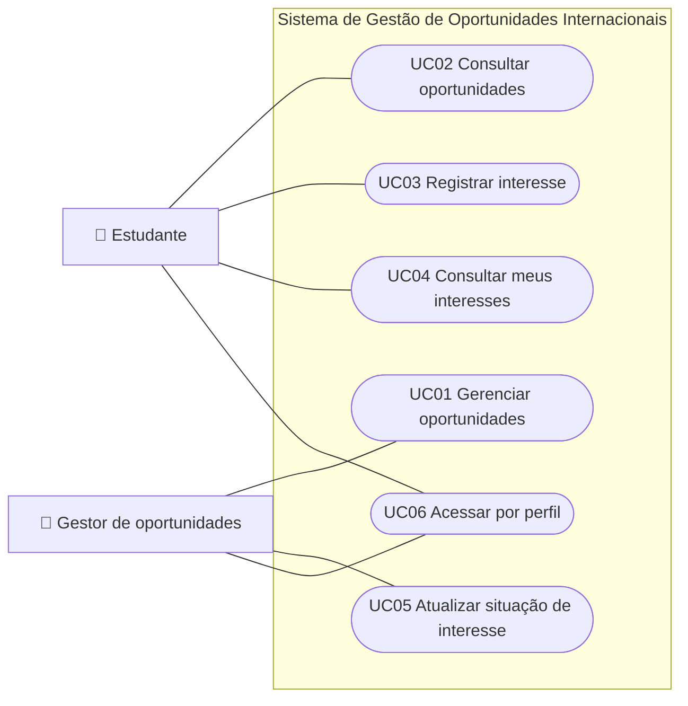
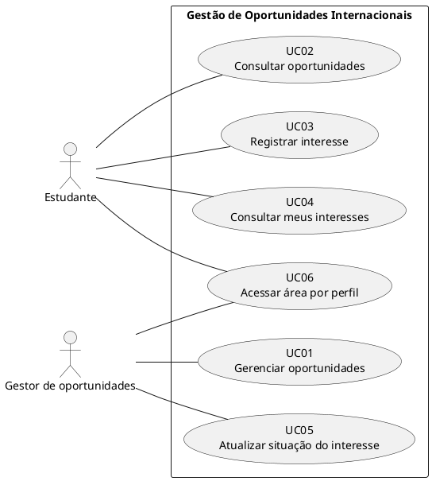

# Modelagem UML inicial — Casos de Uso

> **Proposta 3 | v0.1 | Rascunho acadêmico, não validado.** Atores e relações são hipóteses de análise. O gráfico Mermaid abaixo é uma **representação visual de atores e casos de uso**, não notação UML rigorosa (não usa atores stick-figure nem elipses padronizadas). O código PlantUML no final permite gerar um diagrama UML de casos de uso propriamente dito.

## 1. Limite do sistema
**Sistema:** Gestão de Oportunidades Internacionais. Não abrange candidaturas formais, seleção, atribuição de bolsa, cálculo de elegibilidade ou funções colaborativas de outras propostas.

## 2. Atores
| Ator | Descrição | Situação |
| --- | --- | --- |
| Estudante | Consulta oportunidades e registra/acompaha manifestações | Proposto |
| Gestor de oportunidades | Cadastra, publica, edita e encerra oportunidades; acompanha interesses | Papel institucional real a confirmar |

## 3. Catálogo de casos de uso
| Caso | Nome | Ator principal | Requisitos |
| --- | --- | --- | --- |
| UC01 | Gerenciar oportunidades | Gestor | RF01, RF06 |
| UC02 | Consultar oportunidades | Estudante | RF02 |
| UC03 | Registrar manifestação de interesse | Estudante | RF03 |
| UC04 | Consultar manifestações próprias | Estudante | RF04 |
| UC05 | Atualizar situação de interesse | Gestor | RF05 |
| UC06 | Acessar área identificada por perfil | Estudante/Gestor | RF07 |

## 4. Representação visual no GitHub

## 5. Diagrama UML em PlantUML — fonte editável
Copiar para um renderizador PlantUML para obter a notação UML com atores e casos de uso.

## 6. Pré-condições e resultados
| Caso | Pré-condição | Fluxo principal resumido | Exceções/alternativas propostas | Resultado |
| --- | --- | --- | --- | --- |
| UC01 | Gestor autorizado | Informar oportunidade; validar campos; salvar/publicar | Campos faltantes; edição ou encerramento | Oportunidade cadastrada/publicada ou arquivada |
| UC02 | Nenhuma para consulta pública proposta | Consultar lista; filtrar; abrir detalhes | Nenhum resultado | Exibição de prazo, requisitos e documentos |
| UC03 | Estudante identificado; oportunidade aberta | Escolher oportunidade; solicitar manifestação; confirmar | Prazo encerrado; manifestação duplicada (regra ainda a definir) | Manifestação registrada; aviso de que não é inscrição |
| UC04 | Estudante identificado | Abrir meus interesses; listar situação | Sem interesses | Exibição apenas dos registros próprios |
| UC05 | Gestor autorizado | Consultar manifestações; selecionar registro; atualizar situação (Registrado, Em acompanhamento, Encerrado) | Registro inexistente ou acesso negado | Situação e histórico atualizados |
| UC06 | Usuário inicia sessão no protótipo | Selecionar perfil de estudante/gestor para demonstrar o fluxo autorizado | Perfil não selecionado; operação vedada | Área correspondente exibida |

**Decisões propostas para as telas:** em UC01 oportunidades possuem estados Rascunho, Publicada e Encerrada/Arquivada; em UC03 só pode existir uma manifestação ativa por estudante e oportunidade, sendo exibida a existente em tentativas repetidas. A identificação por perfil é simulada no protótipo; não presume autenticação da Unifor.

## 7. Verificações antes de aprovação
- [ ] Confirmar o papel de gestor e quais campos são exigidos.
- [ ] Validar os estados propostos de oportunidade e manifestação e a regra de duplicidade.
- [ ] Conferir fluxos com responsáveis reais ou obter anuência do professor para a simulação.
- [ ] Gerar imagem UML a partir do PlantUML, caso a entrega exija arquivo gráfico.

[RF](../02-Requisitos/01-Requisitos-Funcionais.md) · [RN](../02-Requisitos/03-Regras-de-Negocio.md) · [Visão](../01-Elicitacao/01-Visao-da-Demanda.md)
