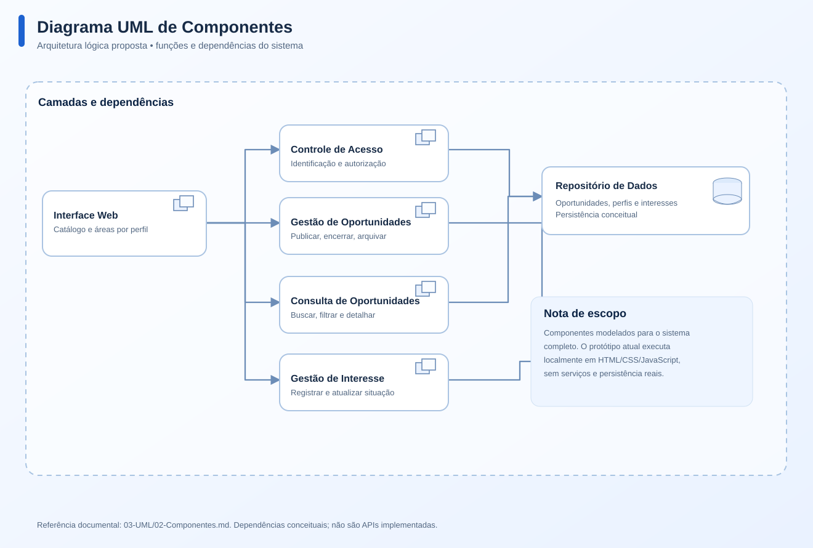
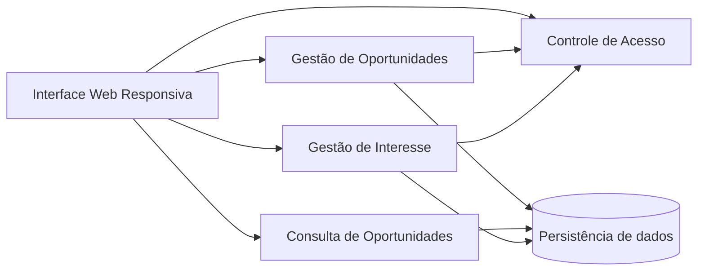
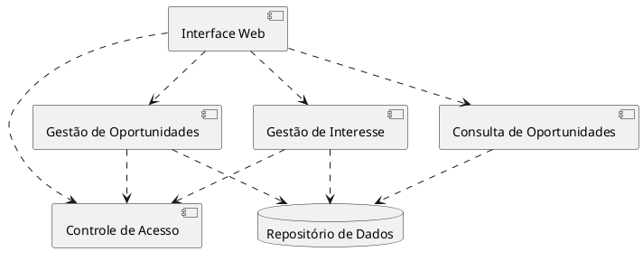

# Modelagem UML inicial — Componentes

> **Proposta 3 | v0.1 | Arquitetura conceitual do sistema.**

## 1. Objetivo
Mostrar as responsabilidades lógicas da solução e suas dependências, sem incluir serviços de candidatura formal ou programas das Propostas 1 e 4.

## 2. Componentes propostos
| Componente | Responsabilidade |
| --- | --- |
| Interface Web | Consulta pública e área autenticada para estudante/gestor |
| Controle de Acesso | Identificação e autorização por perfil |
| Gestão de Oportunidades | Cadastro, edição, publicação, encerramento, arquivamento e desarquivamento de oportunidades, mantendo seu estado e histórico |
| Consulta de Oportunidades | Pesquisa e detalhe de oportunidades publicadas |
| Gestão de Interesse | Registro, consulta e atualização da situação de interesse |
| Persistência | Dados de oportunidades, estudantes e manifestações |

## 3. Diagrama de componentes revisado

[Visualizar o SVG em tamanho completo](05-Diagrama-Componentes.svg).

### Representação conceitual em Mermaid

## 4. Fonte PlantUML do diagrama de componentes

## 5. Interfaces e decisões em aberto
- A comunicação entre interface e serviços é lógica; protocolos não são exigidos nem definidos nesta fase.
- Login institucional não foi confirmado. Nenhuma API acadêmica é pressuposta.
- A divisão em componentes não implica implantação como microsserviços.

[RF](../02-Requisitos/01-Requisitos-Funcionais.md) · [Implantação](03-Implantacao.md).
