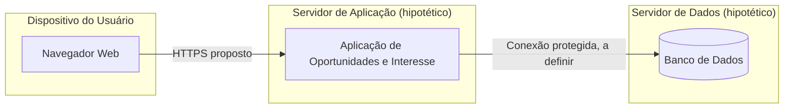
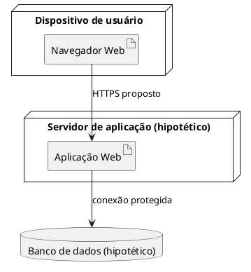

# Modelagem UML inicial — Implantação

> **Proposta 3 | v0.1 | Hipótese de ambiente técnico.** O desenho é um **cenário proposto**, não infraestrutura existente, contratada ou autorizada na Unifor.

## 1. Objetivo
Representar uma implantação web mínima capaz de apresentar oportunidades e registrar manifestações de interesse.

## 2. Nós e artefatos
| Nó | Artefato/serviço proposto | Observação |
| --- | --- | --- |
| Dispositivo do usuário | Navegador web | Estudante ou gestor |
| Servidor de aplicação | Interface e aplicação de oportunidades | Pode ser monólito; tecnologia não definida |
| Serviço de banco de dados | Dados de oportunidades e manifestações | Segurança e backups a definir |

## 3. Diagrama renderizável (topologia conceitual)

## 4. Fonte UML de implantação (PlantUML)

## 5. Dependências, riscos e validação
- Hospedagem, banco, autenticação, monitoramento e backup **não foram definidos**.
- Acesso a dados acadêmicos não é necessário no MVP proposto.
- O uso de HTTPS e de mecanismos de controle de acesso é requisito de projeto, não evidência de implantação existente.
- [ ] Rever viabilidade e segurança com responsável técnico.
- [ ] Exportar imagem UML final se exigida.

[Componentes](02-Componentes.md) · [RNF](../02-Requisitos/02-Requisitos-Nao-Funcionais.md).
