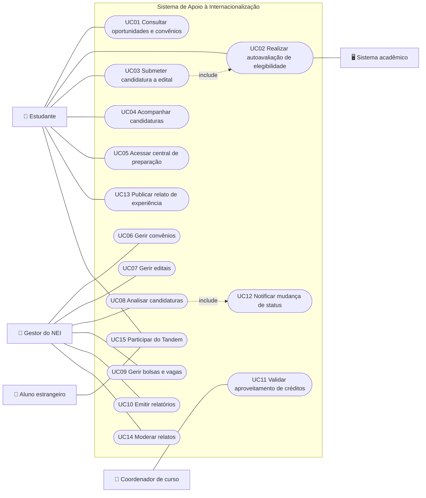
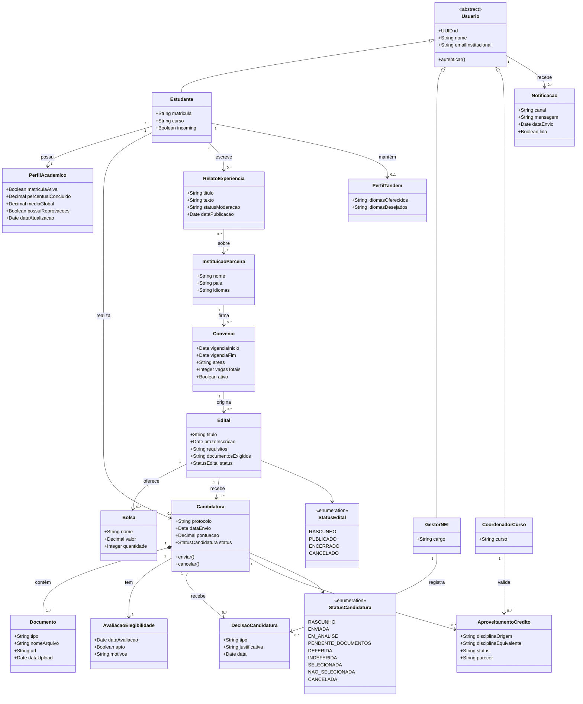
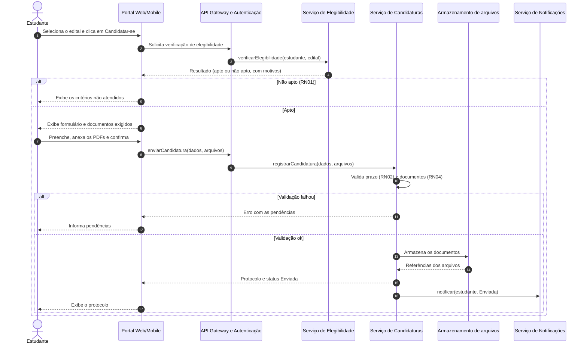
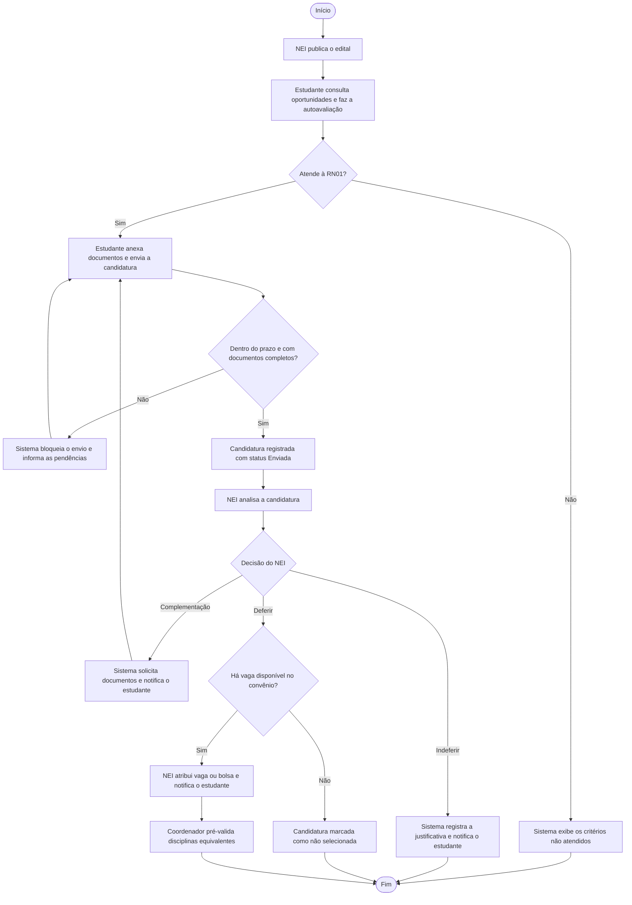
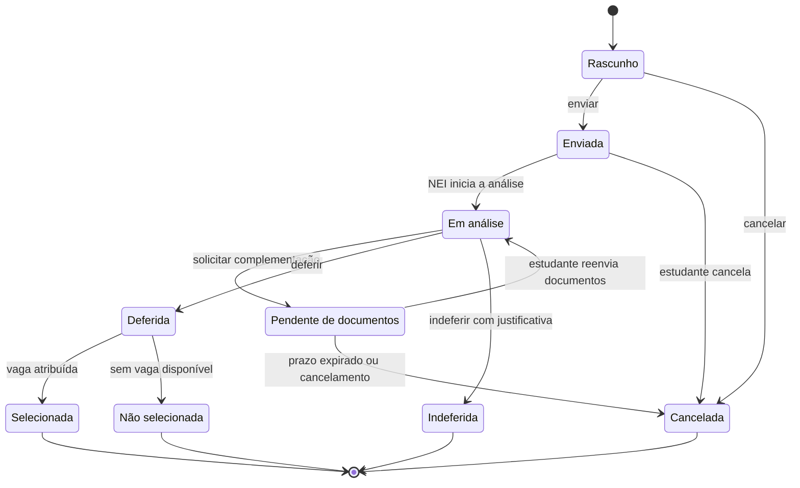
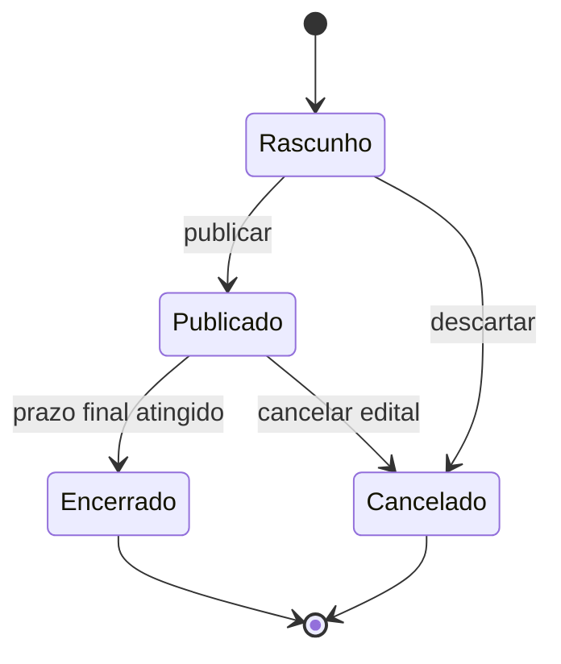
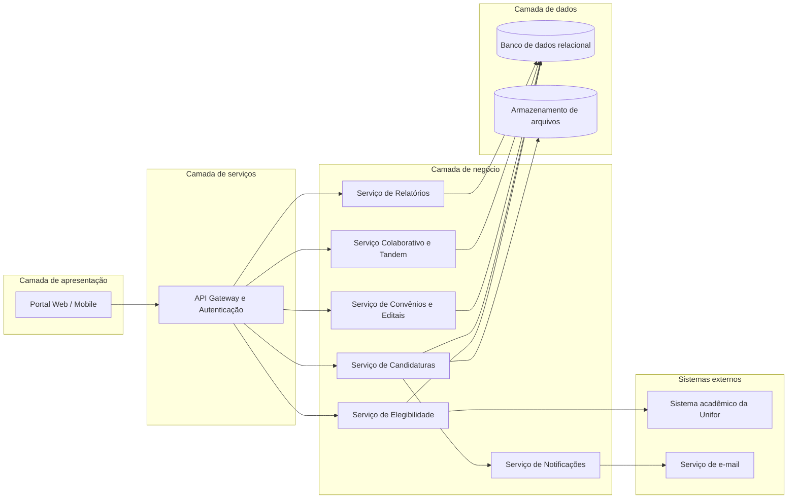
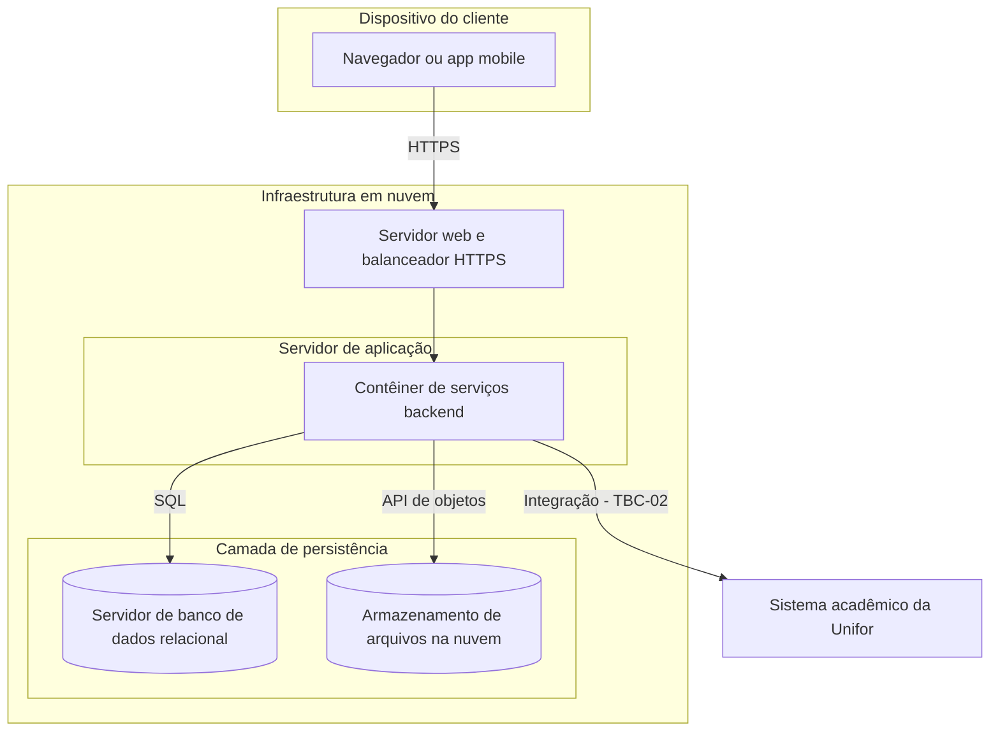

# 📐 Modelagem UML: Sistema de Apoio à Internacionalização

Os diagramas usam [Mermaid](https://mermaid.js.org/) e são renderizados diretamente no GitHub. O Mermaid não possui diagrama de atividades nativo; por isso o diagrama de atividades da seção 6 é representado como fluxograma com decisões.

| # | Diagrama | Seção |
| :-: | :--- | :-: |
| 1 | Casos de uso | 2 |
| 2 | Especificação de casos de uso | 3 |
| 3 | Classes | 4 |
| 4 | Sequência: submissão de candidatura | 5 |
| 5 | Atividades: processo de seleção | 6 |
| 6 | Estados: candidatura e edital | 7 |
| 7 | Componentes | 8 |
| 8 | Implantação | 9 |

---

## 1. Introdução
Os modelos representam os atores, os fluxos de casos de uso, a estrutura de dados, o comportamento do processo seletivo e a arquitetura sugerida da solução. Eles derivam dos requisitos da [SRS](03-Especificacao-SRS.md) e podem ser rastreados na [matriz de rastreabilidade](08-Rastreabilidade.md).

---

## 2. Diagrama de casos de uso

### 2.1 Atores

| Ator | Descrição |
| :--- | :--- |
| **Estudante** | Estudante de graduação que busca oportunidades, candidata-se e acompanha o processo. Quando ex-intercambista, publica relatos. |
| **Aluno estrangeiro (incoming)** | Estudante de instituição parceira; participa do Tandem. |
| **Gestor do NEI** | Cadastra convênios e editais, analisa candidaturas, gerencia bolsas, modera relatos e emite relatórios. |
| **Coordenador de curso** | Valida a equivalência de disciplinas e o aproveitamento de créditos. |
| **Sistema acadêmico** (ator secundário) | Fonte dos dados acadêmicos usados na elegibilidade (**TBC-02**). |

### 2.2 Diagrama

---

## 3. Especificação dos principais casos de uso

### UC02: Realizar autoavaliação de elegibilidade
| Campo | Descrição |
| :--- | :--- |
| **Ator principal** | Estudante |
| **Ator secundário** | Sistema acadêmico |
| **Requisitos** | RF03 · RN01 · US02 |
| **Pré-condição** | Estudante autenticado. |
| **Fluxo principal** | 1. O estudante solicita a autoavaliação. 2. O sistema obtém matrícula, percentual concluído, média e reprovações. 3. O sistema compara cada dado com os critérios da RN01. 4. O sistema exibe o resultado "Apto" com o valor de cada critério. |
| **Fluxo alternativo A** | No passo 4, algum critério não é atendido: o sistema exibe "Não apto" e os critérios não atendidos com o valor do estudante e o exigido. |
| **Fluxo de exceção** | No passo 2, a fonte de dados está indisponível: o sistema informa a falha e orienta a tentar novamente ou procurar o NEI. |
| **Pós-condição** | A data e o resultado da avaliação ficam registrados. |

### UC03: Submeter candidatura a edital
| Campo | Descrição |
| :--- | :--- |
| **Ator principal** | Estudante |
| **Requisitos** | RF04 · RN01 · RN02 · RN04 · RN06 · US03 |
| **Pré-condição** | Estudante autenticado; edital publicado e dentro do prazo. |
| **Fluxo principal** | 1. O estudante escolhe o edital e seleciona "Candidatar-se". 2. O sistema executa UC02 e confirma que o estudante é apto. 3. O sistema exibe o formulário e a lista de documentos exigidos. 4. O estudante preenche os campos e anexa os PDFs. 5. O estudante confirma o envio. 6. O sistema valida prazo e documentos, registra a candidatura com status "Enviada" e gera o protocolo. 7. O sistema notifica o estudante (UC12). |
| **Fluxo alternativo A** | No passo 2, o estudante é inapto: o sistema exibe os motivos e encerra o caso de uso. |
| **Fluxo alternativo B** | No passo 4, o estudante salva o formulário sem enviar: a candidatura fica como "Rascunho". |
| **Fluxo de exceção** | No passo 6, falta documento obrigatório ou o prazo expirou: o sistema bloqueia o envio e informa a pendência. |
| **Pós-condição** | Candidatura registrada com protocolo e status "Enviada". |

### UC08: Analisar candidaturas
| Campo | Descrição |
| :--- | :--- |
| **Ator principal** | Gestor do NEI |
| **Requisitos** | RF08 · RN03 · RNF06 · US05 |
| **Pré-condição** | Gestor autenticado; edital com candidaturas enviadas. |
| **Fluxo principal** | 1. O gestor seleciona um edital. 2. O sistema lista as candidaturas com o resultado da validação automática. 3. O gestor abre uma candidatura e confere os documentos. 4. O gestor registra a decisão: deferir, indeferir ou solicitar complementação. 5. O sistema registra autor, data e decisão e notifica o estudante (UC12). |
| **Fluxo alternativo A** | No passo 4, indeferimento sem justificativa: o sistema exige a justificativa antes de salvar. |
| **Fluxo alternativo B** | Ao deferir além do limite de vagas: o sistema bloqueia a atribuição (RN03). |
| **Pós-condição** | Candidatura com novo status e decisão registrada. |

---

## 4. Diagrama de classes

---

## 5. Diagrama de sequência: submissão de candidatura (UC03)

---

## 6. Diagrama de atividades: processo de seleção

---

## 7. Diagramas de estados

### 7.1 Candidatura

### 7.2 Edital

---

## 8. Diagrama de componentes

Arquitetura **sugerida** em camadas. A escolha final de tecnologias não faz parte da especificação de requisitos.

---

## 9. Diagrama de implantação

