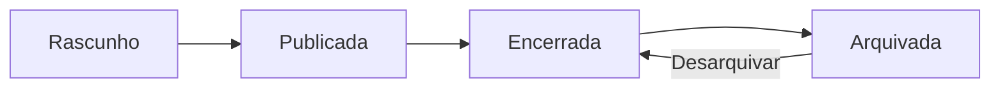
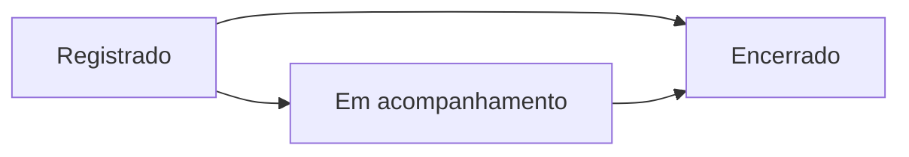

# Especificação de Requisitos de Software (SRS)
## Gestão de Oportunidades Internacionais — Proposta 3

| Identificação | Informação |
| --- | --- |
| Disciplina | Requisitos e Modelagem de Sistemas — Unifor, 2026.2 |
| Equipe | Grupo 7 |
| Entrega | Sprint 2 — Milestone M2 |
| Padrão de organização | IEEE 830 — Introdução, Descrição Geral, Requisitos Específicos |
| Versão | 0.2 |
| Base | Documentação da Entrega 1 publicada na `main` |

> **Base de especificação:** Proposta 3 e documentação de requisitos da primeira etapa, incluindo entrevistas simuladas.

## Histórico de versões

| Versão | Mudança |
| --- | --- |
| 0.1 | Primeira consolidação de RF01–RF07, RNF01–RNF07, RN01–RN09 e UC01–UC06 |
| 0.2 | Revisão de consistência com UML, wireframes e protótipo navegável |

# 1. Introdução

## 1.1 Propósito
Descrever requisitos verificáveis, interações, regras de negócio e restrições do **Sistema de Gestão de Oportunidades Internacionais**, orientando a revisão da modelagem UML, a criação dos wireframes e a construção de um protótipo navegável da Sprint 2.

**Público:** equipe do Grupo 7, professor, revisores acadêmicos e potenciais representantes das áreas envolvidas.

## 1.2 Escopo do produto
Aplicação web responsiva para publicar e consultar oportunidades de mobilidade acadêmica e bolsas, exibir seus requisitos, prazos e documentos, registrar **manifestações de interesse** e acompanhar sua situação.

**Incluído:** consulta de oportunidades; gestão de publicações; manifestações de interesse; visualização de registros próprios; atualização de situação pelo gestor; identificação de perfil para operações restritas.

**Não incluído:** candidatura formal, upload/validação documental de candidatura, avaliação de histórico acadêmico, cálculo automático de elegibilidade, seleção de estudantes, concessão de bolsas, gestão de vistos ou integração com sistemas institucionais não confirmados.

**Limite essencial:** manifestar interesse **não** significa candidatar-se oficialmente, ser selecionado ou receber uma bolsa.

## 1.3 Definições e abreviações

| Termo | Significado |
| --- | --- |
| SRS | Especificação de Requisitos de Software |
| RF / RNF | Requisito funcional / não funcional |
| RN | Regra de negócio |
| UC | Caso de uso |
| US | História de usuário |
| NEI | Núcleo de Estratégias Internacionais, citado no contexto acadêmico; atribuições reais a confirmar |
| Oportunidade | Divulgação de edital, bolsa ou mobilidade com informações para consulta |
| Manifestação de interesse | Registro de interesse do estudante em uma oportunidade, sem inscrição formal |
| Gestor | Papel proposto para o usuário autorizado a administrar oportunidades e situações |

## 1.4 Referências
- [Visão da Demanda — Entrega 1](../01-Elicitacao/01-Visao-da-Demanda.md).
- [Identificação de Stakeholders](../01-Elicitacao/02-Stakeholders.md).
- [Roteiro e entrevistas simuladas](../01-Elicitacao/03-Entrevistas-Simuladas.md).
- [RF de origem](../02-Requisitos/01-Requisitos-Funcionais.md), [RNF de origem](../02-Requisitos/02-Requisitos-Nao-Funcionais.md) e [RN de origem](../02-Requisitos/03-Regras-de-Negocio.md).
- [Casos de Uso (modelagem inicial)](../03-UML/01-Casos-de-Uso.md).
- [Backlog priorizado](../GestaoConfiguracao/01-Backlog-Priorizado.md).
- Material de aula: **Proposta 3 — Gestão de Oportunidades Internacionais**.
- Estrutura documental baseada nas seções principais do padrão **IEEE 830**, conforme exigência da Sprint 2.

## 1.5 Organização deste documento
A seção 2 oferece o contexto do produto. A seção 3 descreve requisitos específicos, dados, interfaces e restrições. A seção 4 detalha casos de uso. As seções 5 e 6 tratam de rastreabilidade, critérios de verificação e pendências.

# 2. Descrição Geral

## 2.1 Perspectiva do produto
O sistema é uma **solução nova, hipotética e independente** para o exercício da Proposta 3. Não há integração obrigatória definida com sistemas acadêmicos. Uma interface web se comunica conceitualmente com funções de consulta, gestão de oportunidades, gestão de manifestações e controle de acesso, com persistência de dados.

Arquitetura de referência: [Componentes](../03-UML/02-Componentes.md) e [Implantação](../03-UML/03-Implantacao.md). Não são evidências de infraestrutura real.

## 2.2 Funções do produto
- **F01 / RF01:** cadastrar e publicar oportunidades.
- **F02 / RF02:** listar, pesquisar, filtrar e consultar detalhes.
- **F03 / RF03:** registrar manifestação de interesse.
- **F04 / RF04:** consultar os próprios interesses.
- **F05 / RF05:** acompanhar e atualizar situação de interesses pelo gestor.
- **F06 / RF06:** editar, encerrar, arquivar e desarquivar oportunidades.
- **F07 / RF07:** distinguir perfis e proteger operações restritas.

## 2.3 Características dos usuários

| Perfil | Necessidade | Permissões previstas |
| --- | --- | --- |
| Visitante | Descobrir oportunidades | Consultar catálogo público e detalhes |
| Estudante identificado | Registrar e acompanhar interesses | Consulta pública, registro e visualização apenas dos próprios interesses |
| Gestor identificado | Manter publicações e situações | Cadastro, edição, publicação, encerramento, arquivamento, desarquivamento e atualização de interesses |
| Sistema externo | Possível integração futura | Não integra o escopo atual |

**Nota:** o perfil Visitante representa o acesso público ao catálogo; ações restritas continuam disponíveis somente a estudantes e gestores identificados.

## 2.4 Restrições gerais
- Interface web adaptável a telas móveis e desktop.
- Dados de interesses sujeitos a controle por perfil e proteção de privacidade.
- O protótipo poderá usar seleção simulada de perfil; isso **não equivale a autenticação segura** de um sistema em produção.
- Sem execução de seleção acadêmica ou aprovação de bolsa.
- Critérios não funcionais serão verificados por testes específicos.

## 2.5 Premissas, dependências e incertezas
- **PR01:** existirão responsáveis por publicar oportunidades — identidade institucional a confirmar.
- **PR02:** oportunidades podem variar em destinos, áreas, datas e documentos — campos concretos a confirmar.
- **PR03:** manifestação de interesse representa um fluxo acadêmico proposto — existência/processo real a confirmar.
- **PR04:** base legal, retenção, mecanismo de login e integrações institucionais continuam indefinidos.
- **PR05:** o levantamento utilizou entrevistas simuladas.

# 3. Requisitos Específicos

## 3.1 Interfaces externas

### 3.1.1 Interface com o usuário
**Telas candidatas ao protótipo**, com organização final a ser definida pelos wireframes: início/catálogo, detalhes da oportunidade, entrada por perfil, meus interesses, painel do gestor, cadastro/edição de oportunidade e gestão de manifestações. Podem compartilhar telas ou usar diálogos.

### 3.1.2 Interfaces de hardware
Navegador de dispositivo móvel ou computador; não se pressupõem sensores ou hardware adicional.

### 3.1.3 Interfaces de software
Persistência de oportunidades, identidades/perfis e manifestações. **Nenhuma API da Unifor foi confirmada.** Protocolos, bibliotecas, banco de dados e hospedagem não foram escolhidos.

### 3.1.4 Interfaces de comunicação
Acesso web protegido (HTTPS proposto para produção) e conexão protegida ao armazenamento. Os wireframes/protótipo podem simular essas interações sem operar rede ou backend.

## 3.2 Requisitos funcionais

**RF01 — Cadastrar e publicar oportunidades**
- **Ator:** gestor identificado; **Prioridade:** Must.
- **Entrada mínima proposta:** título, descrição, tipo (edital/bolsa), prazo, requisitos, documentos necessários e destino quando aplicável.
- **Processamento:** validar informações mínimas; registrar em Rascunho; permitir Publicação apenas de registro válido.
- **Saída:** oportunidade publicada aparece no catálogo; falha de validação apresenta campo e motivo.
- **Regras:** RN01, RN02, RN08; **UC:** UC01; **US:** US01.
- **Aceitação:** publicação válida visível na consulta; dados obrigatórios ausentes impedem publicação.

**RF02 — Consultar oportunidades**
- **Ator:** estudante/visitante; **Prioridade:** Must.
- **Entrada:** busca textual e filtros independentes por destino, área e tipo.
- **Processamento:** retornar somente oportunidades publicadas de acordo com os filtros; ao selecionar uma, apresentar requisitos, prazo e documentos.
- **Saída:** lista e página de detalhes; aviso de “nenhuma oportunidade encontrada” quando aplicável.
- **UC:** UC02; **US:** US02.
- **Aceitação:** o detalhe possui informações essenciais; filtros exibem resultados coerentes; estado sem resultados é explícito.

**RF03 — Registrar manifestação de interesse**
- **Ator:** estudante identificado; **Prioridade:** Must.
- **Pré-condição:** oportunidade publicada e dentro do prazo; estudante com perfil válido.
- **Entrada:** ação de manifestar interesse e confirmação.
- **Processamento:** associar estudante e oportunidade; verificar se existe interesse ativo duplicado.
- **Saída:** novo registro em estado **Registrado**, ou apresentação de registro ativo já existente. Mensagem explicita não equivaler a candidatura formal.
- **Regras:** RN03, RN04, RN07, RN08, RN09; **UC:** UC03; **US:** US03.
- **Aceitação:** registra uma única manifestação ativa; impede prazo vencido; esclarece natureza do registro.

**RF04 — Consultar manifestações próprias**
- **Ator:** estudante identificado; **Prioridade:** Should.
- **Processamento:** listar apenas registros do estudante, com oportunidade, data de registro e situação.
- **Saída:** lista dos próprios interesses ou estado vazio.
- **Regras:** RN05, RN09; **UC:** UC04; **US:** US04.
- **Aceitação:** um estudante não visualiza registros de outro; estados aparecem corretamente.

**RF05 — Atualizar situação de manifestações**
- **Ator:** gestor identificado; **Prioridade:** Should.
- **Processamento:** consultar manifestações autorizadas e alterar estado de **Registrado** para **Em acompanhamento** ou **Encerrado**, registrando usuário responsável e data. Transições intermediárias exatas ainda dependem de confirmação.
- **Saída:** situação e histórico mínimo atualizados para gestor e estudante titular.
- **Regras:** RN05, RN09; **UC:** UC05; **US:** US05.
- **Aceitação:** mudança autorizada é refletida na consulta; ação não representa seleção ou bolsa concedida.

**RF06 — Editar, encerrar, arquivar e desarquivar oportunidades**
- **Ator:** gestor identificado; **Prioridade:** Should.
- **Processamento:** editar dados, encerrar oportunidades publicadas, arquivar oportunidades encerradas e desarquivar, retornando ao estado Encerrada; impedir novo interesse em oportunidade encerrada ou fora do prazo; preservar histórico conforme política de retenção a definir.
- **Saída:** oportunidade com estado atualizado; interesses já existentes mantidos conforme política.
- **Regras:** RN01, RN03, RN06, RN08; **UC:** UC01; **US:** US06.
- **Aceitação:** (1) encerrar uma oportunidade publicada bloqueia novos interesses; (2) arquivar uma oportunidade encerrada move seu registro ao arquivo administrativo; (3) desarquivar devolve a oportunidade ao estado Encerrada, sem republicação; (4) manifestações existentes permanecem acessíveis aos perfis autorizados.

**RF07 — Identificação e autorização por perfil**
- **Atores:** estudante e gestor; **Prioridade:** Must (suporte).
- **Processamento:** em produção, validar identidade/autorização antes de funções restritas. No **protótipo**, disponibilizar alternância ou entrada simulada como estudante/gestor, rotulada como demonstração.
- **Saída:** acesso apenas aos fluxos permitidos pelo papel selecionado/identificado.
- **Regras:** RN01, RN05; **UC:** UC06; **US:** US07.
- **Aceitação:** estudante não acessa controles administrativos; visitante não registra interesses sem entrar como estudante; simulação não é apresentada como login seguro.

## 3.3 Requisitos não funcionais

| ID | Categoria | Requisito e métrica proposta | Verificação | Situação |
| --- | --- | --- | --- | --- |
| RNF01 | Desempenho | Listagem e detalhe em até **3 s**, sob cenário/carga ainda a definir | Teste com ambiente e carga registrados | Verificação prevista |
| RNF02 | Responsividade | Telas úteis em celular e desktop; largura de **360 px** como referência inicial | Testes visuais com diferentes viewports | Referência proposta |
| RNF03 | Confiabilidade | Preservação de registros e capacidade de recuperação após falhas recuperáveis; periodicidade de backup a definir | Simulação/teste de restauração após definir política | Parcialmente especificado |
| RNF04 | Segurança | Autorização por perfil e proteção de tráfego pessoal | Testes de permissão; verificação HTTPS em implantação | Verificação prevista |
| RNF05 | Privacidade | Minimizar dados pessoais e definir finalidade, base legal, retenção | Inspeção de dados e política de tratamento | Políticas pendentes |
| RNF06 | Acessibilidade | Almejar **WCAG 2.1 AA** | Avaliação de teclado, contraste, rótulos e navegação | Meta proposta |
| RNF07 | Clareza | Confirmação da manifestação informa que não é candidatura formal | Teste de entendimento de cenário | Proposto |

**Escopo de verificação:** o protótipo demonstra navegação, filtros, formulários, estados e avisos de interface. As metas RNF01 (desempenho), RNF03 (persistência/recuperação), RNF04 (segurança efetiva), RNF05 (tratamento de dados) e RNF06 (acessibilidade) exigem implementação ou testes específicos do sistema completo; não são comprovadas pela demonstração HTML. A RNF02 pode ser inspecionada visualmente em diferentes larguras de tela, enquanto a RNF07 pode ser observada na confirmação de interesse. A seleção de perfil no protótipo não substitui autenticação real.

## 3.4 Regras de negócio aplicáveis

| ID | Regra proposta | Requisitos impactados |
| --- | --- | --- |
| RN01 | Publicar/editar somente como gestor autorizado | RF01, RF06, RF07 |
| RN02 | Publicar somente com campos mínimos válidos | RF01 |
| RN03 | Prazo vencido ou encerramento impede novos interesses | RF03, RF06 |
| RN04 | Interesse não é candidatura formal | RF03 |
| RN05 | Acesso apenas a manifestações autorizadas | RF04, RF05, RF07 |
| RN06 | Encerramento não elimina automaticamente histórico | RF06 |
| RN07 | Impedir manifestação ativa duplicada para a mesma oportunidade/estudante | RF03 |
| RN08 | Estados de oportunidade: Rascunho, Publicada, Encerrada, Arquivada | RF01, RF03, RF06 |
| RN09 | Estados de interesse: Registrado, Em acompanhamento, Encerrado | RF03, RF04, RF05 |

As regras aplicáveis ao sistema estão detalhadas em [Regras de Negócio](../02-Requisitos/03-Regras-de-Negocio.md).

## 3.5 Dados conceituais e consistência

| Entidade conceitual | Campos mínimos sugeridos | Observação |
| --- | --- | --- |
| Oportunidade | id, título, descrição, tipo, destino (opcional), área (quando aplicável), prazo, requisitos, documentos, estado | Cadastro detalhado a confirmar |
| Perfil de usuário | id, papel (estudante/gestor) | Identidade real e armazenamento não definidos |
| Manifestação | id, oportunidade, estudante, situação, data do registro, histórico de atualizações | Não é candidatura formal |
| Evento de atualização | id, manifestação, gestor responsável, data, estado anterior/novo | Histórico mínimo proposto |

**Relações propostas:** uma oportunidade admite várias manifestações; cada manifestação pertence a exatamente um estudante e uma oportunidade; um estudante pode manifestar interesse em várias oportunidades, mas possui **no máximo uma manifestação ativa por oportunidade** (RN07).

**Regras de integridade:** cada manifestação precisa de estudante e oportunidade válidos; atualização de situação precisa de gestor autorizado; não permitir publicação com dados mínimos incompletos. Não há modelo de dados lógico ou banco escolhido nesta fase.

## 3.6 Regras de estados (para o protótipo)

**Operações do gestor:** Encerrar interrompe novas manifestações; Arquivar transfere a oportunidade encerrada para o arquivo administrativo. Desarquivar devolve o registro ao estado Encerrada, sem republicação ou reabertura de manifestações. O histórico é preservado.

# 4. Especificação Detalhada dos Casos de Uso

## UC01 — Gerenciar oportunidades
- **Ator principal:** gestor.
- **Requisitos:** RF01, RF06; **RN:** RN01, RN02, RN03, RN06, RN08.
- **Pré-condições:** usuário identificado como gestor.
- **Gatilho:** gestor escolhe criar, editar, publicar, encerrar, arquivar ou desarquivar oportunidade.
- **Fluxo principal:** (1) abrir área administrativa; (2) escolher cadastrar; (3) preencher informações da oportunidade; (4) validar os campos; (5) salvar rascunho; (6) publicar quando estiver completo; (7) exibir confirmação e disponibilizar no catálogo.
- **Alternativas:** (A1) editar oportunidade existente e salvar alterações; (A2) encerrar publicação, impedindo novos interesses; (A3) arquivar oportunidade encerrada, preservando o histórico e retirando-a da lista de gestão ativa; (A4) desarquivar, retornando à lista de gestão no estado Encerrada.
- **Exceções:** (E1) dados obrigatórios ausentes bloqueiam publicação; (E2) perfil sem permissão não acessa a operação.
- **Pós-condições:** oportunidade criada/atualizada com estado correspondente; manifestações existentes preservadas conforme política.
- **Testes sugeridos:** publicar sem prazo (bloquear), corrigir e publicar (listar no catálogo), encerrar (bloquear novo interesse), arquivar (mover ao arquivo do gestor) e desarquivar (retornar a Encerrada, sem republicar nem apagar manifestações).

## UC02 — Consultar oportunidades
- **Ator principal:** estudante ou visitante.
- **Requisito:** RF02.
- **Pré-condições:** catálogo disponível; sem autenticação para consulta pública proposta.
- **Gatilho:** abrir catálogo ou aplicar filtro.
- **Fluxo principal:** (1) abrir listagem; (2) consultar oportunidades publicadas; (3) pesquisar ou filtrar por atributos existentes; (4) escolher uma oportunidade; (5) ler título, descrição, requisitos, prazos e documentos.
- **Alternativas:** (A1) limpar filtros; (A2) retornar ao catálogo.
- **Exceções:** (E1) nenhum resultado exibe mensagem clara; (E2) oportunidade não disponível exibe aviso e permite voltar.
- **Pós-condições:** informações consultadas, sem alteração dos dados.
- **Teste sugerido:** filtrar separadamente por tipo, destino e área; combinar filtros, consultar detalhes e testar lista vazia.

## UC03 — Registrar manifestação de interesse
- **Ator principal:** estudante identificado.
- **Requisito:** RF03; **RN:** RN03, RN04, RN07, RN08, RN09.
- **Pré-condições:** perfil estudante; oportunidade publicada com prazo aberto.
- **Gatilho:** selecionar “Manifestar interesse”.
- **Fluxo principal:** (1) abrir detalhe; (2) selecionar manifestação; (3) receber explicação de que não é inscrição oficial; (4) confirmar; (5) verificar prazo, estado e duplicidade; (6) salvar estado **Registrado**; (7) exibir confirmação e acesso a “Meus interesses”.
- **Alternativas:** (A1) estudante cancela antes de confirmar; (A2) se já existe manifestação ativa, apresentar a existente.
- **Exceções:** (E1) usuário não identificado solicita entrada como estudante; (E2) prazo encerrado ou oportunidade indisponível bloqueia ação.
- **Pós-condições:** no máximo uma manifestação ativa por oportunidade/estudante; nenhuma candidatura formal criada.
- **Teste sugerido:** interesse válido, repetição e tentativa após encerramento.

## UC04 — Consultar minhas manifestações
- **Ator principal:** estudante identificado.
- **Requisito:** RF04; **RN:** RN05, RN09.
- **Pré-condições:** identidade de estudante.
- **Gatilho:** abrir “Meus interesses”.
- **Fluxo principal:** (1) recuperar somente manifestações associadas ao estudante; (2) exibir oportunidade, data e situação; (3) opcionalmente consultar histórico resumido.
- **Alternativas:** (A1) nenhuma manifestação, exibir estado vazio.
- **Exceções:** (E1) tentativa de abrir registro de outro estudante é negada.
- **Pós-condições:** dados não são modificados.
- **Teste sugerido:** sob perfil Estudante, visualizar somente os interesses associados ao estudante demonstrativo; sob Visitante/Gestor, conferir que a tela 'Meus interesses' não é exibida. O isolamento entre contas reais depende da implementação de autenticação.

## UC05 — Atualizar situação de interesse
- **Ator principal:** gestor identificado.
- **Requisito:** RF05; **RN:** RN05, RN09.
- **Pré-condições:** gestor autorizado; manifestação existente.
- **Gatilho:** gestor abre manifestações e escolhe atualizar.
- **Fluxo principal:** (1) listar registros autorizados; (2) escolher manifestação; (3) consultar status; (4) selecionar novo estado dentre os previstos; (5) confirmar; (6) registrar gestor e data; (7) apresentar situação atualizada.
- **Alternativas:** (A1) cancelar mudança sem salvar.
- **Exceções:** (E1) transição inválida não é permitida; (E2) falta de permissão bloqueia acesso.
- **Pós-condições:** situação atualizada e rastreável, sem aprovação de candidatura.
- **Teste sugerido:** alterar Registrado para Em acompanhamento e observar a mudança na visão do estudante.

## UC06 — Acessar área por perfil
- **Atores:** estudante, gestor.
- **Requisito:** RF07; **RN:** RN01, RN05.
- **Pré-condições:** interface disponível.
- **Gatilho:** usuário solicita acesso a função restrita ou abre entrada por perfil.
- **Fluxo de demonstração:** (1) escolher perfil no protótipo; (2) exibir área permitida; (3) acessar operações desse papel; (4) permitir sair ou trocar de demonstração.
- **Exceções:** (E1) visitante sem perfil não registra interesse; (E2) estudante não acessa funções de gestor.
- **Pós-condições:** navegação de protótipo por papel; **não é login de produção**.
- **Teste sugerido:** tentar abrir telas administrativas sob perfil estudante.

# 5. Rastreabilidade

| Necessidade | RF | RNF principais | Regras | UC | História | Protótipo — telas candidatas |
| --- | --- | --- | --- | --- | --- | --- |
| NEC02 | RF01 | RNF04 | RN01, RN02, RN08 | UC01 | US01 | Painel gestor; cadastro/edição |
| NEC01 | RF02 | RNF01, RNF02, RNF06 | RN08 | UC02 | US02 | Catálogo; detalhe |
| NEC03 | RF03 | RNF04, RNF05, RNF07 | RN03, RN04, RN07, RN08, RN09 | UC03 | US03 | Detalhe; confirmação |
| NEC03 | RF04 | RNF04, RNF05 | RN05, RN09 | UC04 | US04 | Meus interesses |
| NEC03 | RF05 | RNF04, RNF05 | RN05, RN09 | UC05 | US05 | Gestão de manifestações |
| NEC02 | RF06 | RNF03, RNF04 | RN01, RN03, RN06, RN08 | UC01 | US06 | Painel gestor; cadastro/edição |
| NEC02/03 | RF07 | RNF04 | RN01, RN05 | UC06 | US07 | Entrada por perfil |

**Nota:** vínculos de rastreabilidade reunidos para revisão cruzada na Issue #7.

# 6. Verificação, Validação e Questões em Aberto

## 6.1 Critérios de verificação da entrega
- [x] Introdução, descrição geral e requisitos específicos estruturados conforme solicitação da Sprint 2.
- [x] Requisitos funcionais, não funcionais e regras da primeira entrega consolidados sem perder identificadores.
- [x] Casos de uso UC01–UC06 descritos com pré-condições, fluxos, alternativas e pós-condições.
- [x] Rastreabilidade inicial elaborada.
- [x] Consistência documental revisada com diagramas UML e seus catálogos (Issue #7).
- [x] Wireframes e protótipo navegável vinculados aos RF/UC (Issues #8 e #9).
- [ ] Revisão final da equipe e avaliação docente.
- [ ] Executar testes de aceitação, responsividade e acessibilidade com o grupo.

## 6.2 Pendências relevantes

| ID | Tema | Decisão necessária | Efeito |
| --- | --- | --- | --- |
| P01 | Identificação | Login local, autenticação institucional ou apenas simulação na entrega | RF07, UC06 |
| P02 | Publicação | Campos exatos obrigatórios e estados definitivos | RF01, RF06, UC01 |
| P03 | Interesse | Significado institucional de manifestação, duplicidade e possíveis reaberturas | RF03–RF05 |
| P04 | Dados pessoais | Finalidade, base legal e retenção | RNF05, RN06 |
| P05 | Infraestrutura | Hospedagem, backup, autenticação e capacidade | RNF01, RNF03–RNF04 |
| P06 | Aceite | Revisão formal das hipóteses e protótipo por equipe/professor | Entrega M2 |

**Situação:** SRS v0.2 consolidada e alinhada documentalmente aos artefatos da Sprint 2; testes finais de execução e revisão da equipe pendentes.
