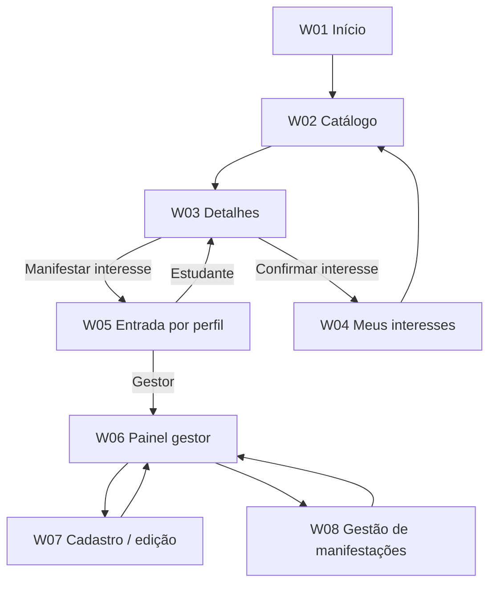

# Wireframes — Gestão de Oportunidades Internacionais

**Sprint 2 • Issue #8 • Proposta 3**

Wireframes de baixa fidelidade das oito telas principais do sistema. Os arquivos SVG podem ser visualizados diretamente no GitHub ou abertos no navegador; representam a estrutura e o conteúdo das telas, **não** o protótipo navegável (Issue #9).

**Referência visual do protótipo implementado:** [Design System](04-Design-System.md). Os wireframes são deliberadamente de baixa fidelidade; o HTML navegável aplica a identidade visual final sem modificar os fluxos documentados.

## Pranchas visuais

- [Wireframes do Estudante — SVG](01-Wireframes-Estudante.svg) — W01 a W04.
- [Wireframes de Acesso e Gestor — SVG](02-Wireframes-Gestor.svg) — W05 a W08.

## Telas e rastreabilidade

| Tela | Finalidade | Perfil | Requisitos / casos de uso |
| --- | --- | --- | --- |
| W01 — Página inicial | Apresentar a plataforma e dar acesso ao catálogo | Público | RF02 / UC02 |
| W02 — Catálogo | Buscar, filtrar e selecionar oportunidades publicadas | Público | RF02 / UC02 |
| W03 — Detalhes | Exibir descrição, prazos, requisitos e documentos; iniciar manifestação | Público / estudante | RF02, RF03 / UC02, UC03 |
| W04 — Meus interesses | Visualizar registros próprios e situação | Estudante | RF04 / UC04 |
| W05 — Entrada por perfil | Simular a entrada como estudante ou gestor | Estudante / gestor | RF07 / UC06 |
| W06 — Painel do gestor | Consultar e administrar oportunidades (incluindo arquivo) e acompanhar interesses | Gestor | RF01, RF05, RF06 / UC01, UC05 |
| W07 — Cadastro / edição | Criar, salvar, editar, publicar, encerrar, arquivar e desarquivar oportunidades | Gestor | RF01, RF06 / UC01 |
| W08 — Gestão de manifestações | Consultar e atualizar estados dos registros de interesse | Gestor | RF05 / UC05 |

## Mapa de navegação

## Comportamentos a considerar no protótipo navegável

1. A consulta do catálogo e dos detalhes é pública. Manifestar interesse requer o perfil Estudante.
2. O botão de manifestação só permite concluir o registro quando a oportunidade está **Publicada** e dentro do prazo (RN03/RN08).
3. A confirmação informa que **manifestação de interesse não constitui candidatura formal** (RN04).
4. Em caso de manifestação ativa já existente para o mesmo estudante e oportunidade, exibir o registro anterior em vez de criar duplicidade (RN07).
5. O estudante vê apenas as próprias manifestações. O gestor acessa a área de gestão pelo perfil correspondente (RN05/RF07).
6. Na publicação, campos obrigatórios incompletos são indicados e impedem a mudança de Rascunho para Publicada (RN02).
7. O gestor acompanha as manifestações nos estados Registrado, Em acompanhamento e Encerrado (RN09); o histórico registra responsável e data (RF05).
8. Oportunidades encerradas não aceitam novos interesses; o gestor pode arquivá-las em uma seção separada e desarquivá-las de volta ao estado Encerrada, mantendo os registros anteriores para consulta (RN06/RN08). Os wireframes do gestor mostram as ações de encerramento, arquivamento e desarquivamento.
9. Campos e exemplos visuais nas pranchas são ilustrativos; a entrada por perfil será demonstrativa, sem autenticação real.

## Conferência da Sprint 2

- [x] Esboços de oito telas documentados em SVG.
- [x] Rastreabilidade entre telas, RF e UC.
- [x] Mapa geral de navegação criado.
- [ ] Testar os fluxos no protótipo navegável (Issue #9).
- [ ] Fazer conferência final de usabilidade e revisão pelo grupo.

**Especificação de referência:** [SRS IEEE 830](../04-SRS/01-SRS-IEEE830.md) • [Revisão de consistência](../05-Validacao/01-Revisao-de-Consistencia.md).
